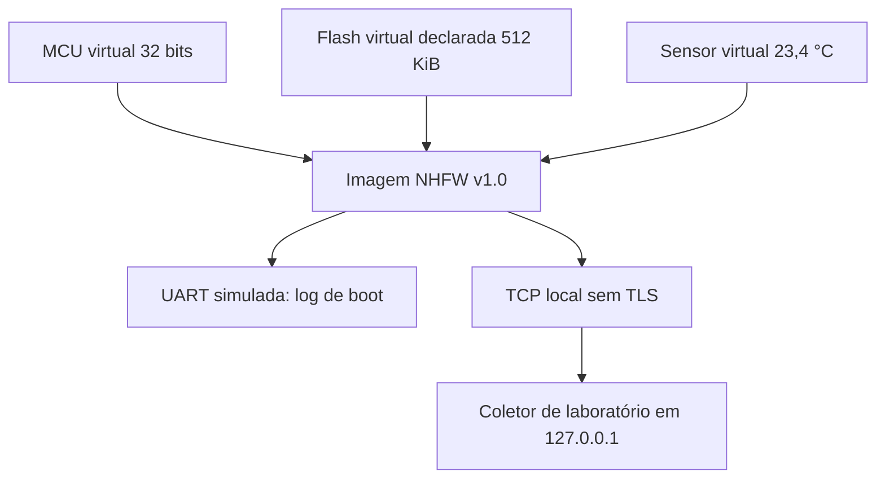

# Arquitetura do NexaHome Lab S1

**Tipo:** dispositivo educacional inteiramente simulado em Node.js. Não há placa, MCU, barramento ou alimentação físicos. O “firmware” é uma imagem de configuração no formato didático NHFW, gerada pelo próprio projeto.

| Componente | Identificação | Evidência | Limite |
|---|---|---|---|
| MCU | Virtual 32 bits | `src/lab-assessment.mjs`, campo `mcu` da imagem | Não representa silício real |
| Memória | Flash virtual declarada 524288 bytes | Manifesto NHFW | Não foi medida fisicamente |
| Sensor | Temperatura virtual de 23,4 °C | `evidence/simulation/network-observation.txt` | Dado fixo de teste |
| UART | Saída de boot simulada | `evidence/simulation/uart-observation.txt` | Não há pinos ou níveis elétricos |
| Comunicação | TCP loopback, JSON por linha | `evidence/simulation/network-observation.txt` | Tráfego de aplicação, não captura de pacotes |
| Alimentação | Processo Node.js no computador | Código-fonte | Sem circuito físico |
| Serviço | Coletor local temporário | Código-fonte | Sem nuvem ou serviço externo |

## Superfície de ataque observada

| Entrada | Ator/acesso necessário | Informação observada | Controle |
|---|---|---|---|
| Imagem NHFW | Acesso ao arquivo gerado | Token fictício em texto claro | Nenhuma criptografia na imagem |
| UART simulada | Acesso ao log de boot | Token fictício | Nenhuma redação no log |
| TCP loopback | Processo no mesmo host/caminho local | Identificador, temperatura e token fictício | Sem TLS ou autenticação do coletor |

A superfície de um produto comercial dependeria de alcance físico e de rede reais. O laboratório não permite inferir esses alcances.
