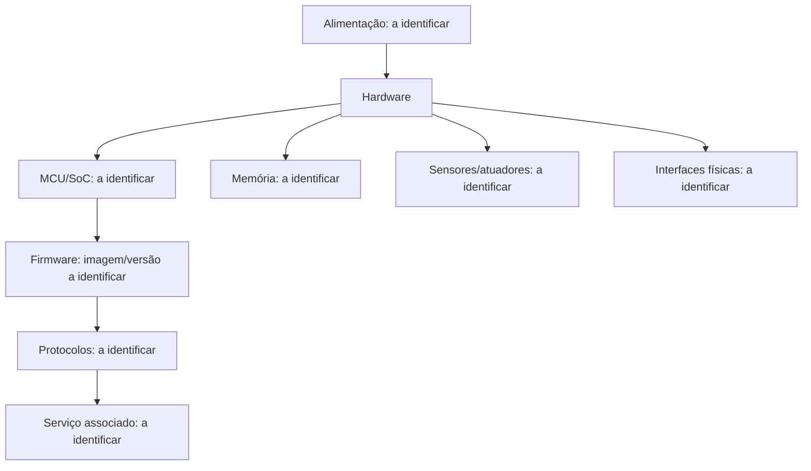

# Arquitetura e reconhecimento

**Estado:** modelo a confirmar por inspeção, documentação e evidências.

| Componente | Modelo/versão | Como foi identificado | Evidência | Estado |
|---|---|---|---|---|
| MCU/SoC | — | — | — | Pendente |
| Memória volátil | — | — | — | Pendente |
| Armazenamento | — | — | — | Pendente |
| Sensores/atuadores | — | — | — | Pendente |
| Interface de rede | — | — | — | Pendente |
| Alimentação | — | — | — | Pendente |
| Serviço externo/local | — | — | — | Pendente |

## Superfície de ataque
| Entrada ou fronteira | Ator e acesso necessários | Dados/função expostos | Controle observado | Evidência |
|---|---|---|---|---|
| Interface física | A identificar | A identificar | A verificar | — |
| Rede local | A identificar | A identificar | A verificar | — |
| Atualização de firmware | A identificar | A identificar | A verificar | — |
| Serviço associado | A identificar | A identificar | A verificar | — |
